# Factory demo runbook

Shows every way a human steers the factory, using this repo's seeded issues. Issue numbers change on
every reset, so the runbook names issues by title.

## Setup

Setup changes (config, charter, skills, CI) and demo output are handled differently by `reset`, which
force-pushes `main` back to the `baseline` tag and drops anything merged after it:

1. Merge any setup PR into `main`.
2. `bin/factory rebaseline --repo-dir ../splitbill-demo` moves the tag onto the new `main`, keeping the setup.
3. `bin/factory reset --repo-dir ../splitbill-demo --dry-run`, then without `--dry-run`. The dry-run lists every
   `drop-commit`; that list should be empty.

```bash
cd ../factory
bin/factory doctor --repo-dir ../splitbill-demo --fix
make up REPO_DIR=../splitbill-demo          # runner + dashboard on http://localhost:4100
```

The runner polls every 15 seconds. All human input is GitHub state: a label, an issue comment, a PR
comment or review, or a dashboard button (which posts the same comment). Only OWNER, MEMBER and
COLLABORATOR count. A PR is a draft while the factory works and is marked ready for review when it hands
over to you.

## Checkpoints

Each session in `teach/sessions.json` (in the `factory` repo) names an immutable `checkpoint/<id>` tag
here, the exact starting state its demo steps and seeded issues run against, kept stable even as `main`
moves on. A participant preparing for one session checks it out instead of `main`:

```bash
git fetch --tags
git checkout checkpoint/lightning-3     # or module-1, module-2, ...
```

## Live sequence

| Step | Issue (by title) | Human action, and where | What you see |
|---|---|---|---|
| 1 | "Splitting $10.00 three ways loses a cent", "CSV export shows raw cents" | add label `factory:ready` on the issue | low risk plans auto-approve, build, and a PR opens, marked ready for review |
| 2 | "README has no run steps" | on its PR, comment `/factory revise <what to change>` | the PR goes back to draft, gets a new commit, and is marked ready again; no second PR |
| 3 | "Expense search leaks other groups' expenses" | comment `/factory revise <text>` on the issue at `awaiting-approval`, then `/factory approve` | plan revision 2, then build |
| 4 | "Upgrade hono 3.12.12 to 4.x" | high risk plan: comment `/factory cancel` | issue closed, worktree removed |
| 5 | "Any group member can delete any other member's expense" | none: it needs a protected path | refused at triage, nothing built |
| 6 | "Make settling up easier" | the agent asks a question: answer in the dashboard, or as a plain issue comment | resumes at the stage that asked |
| 7 | none | `bin/factory scan --repo-dir ../splitbill-demo` | files the nanoid advisory as an issue |

## Paths you cannot force live

Timeouts, verify rejects, red gates, boundary hits, denied tools, a lost claim and crash recovery are
replayed offline, one named test each:

```bash
cd ../factory && bun test tests/scenarios.test.ts
```

A structural test in that file fails if any state label has no scenario, so a new state cannot ship
untested.

## Deliver and reset

`main` requires a code-owner approval and the runner posts as you, so you cannot approve a factory PR
yourself. Merge one with an admin bypass (`gh pr merge <n> --squash --admin`), then run
`bin/factory reset --repo-dir ../splitbill-demo`: the dry-run lists that merge as a `drop-commit`, and the real
reset puts `main` back on the baseline. The factory never merges.

`main` is protected, so rewinding it needs "Allow force pushes" on for you (Settings, Branches). Turn it on
first; if it is off the reset fails on its first push and changes nothing. Turn it off again afterwards.

## Lightning-2: step by step (v2.12.0 run, 2026-10-01)

A real run of `teach/lightning-2.md` from software-factory, on runner v2.12.0. The links open the exact
issues and PRs from this run. `reset` closed them afterwards and reseeded the tickets under new numbers,
but they stay readable on GitHub. Screenshots are in `docs/demo/lightning-2/`.

| Ticket | Issue | PR | Outcome |
|---|---|---|---|
| README has no run steps or CLI example | [#46](https://github.com/learnwithparam/splitbill-demo/issues/46) | [#54](https://github.com/learnwithparam/splitbill-demo/pull/54) | PR opened, then a revise that changed nothing (bug 3) |
| Splitting $10.00 three ways loses a cent | [#47](https://github.com/learnwithparam/splitbill-demo/issues/47) | [#53](https://github.com/learnwithparam/splitbill-demo/pull/53) | PR ready, verdict pass |
| CSV export shows raw cents | [#48](https://github.com/learnwithparam/splitbill-demo/issues/48) | [#55](https://github.com/learnwithparam/splitbill-demo/pull/55) | operator takeover mid-build, then PR ready |
| Any group member can delete any other member's expense | [#50](https://github.com/learnwithparam/splitbill-demo/issues/50) | none | refused at triage: protected path |
| Upgrade hono 3.12.12 to 4.x | [#51](https://github.com/learnwithparam/splitbill-demo/issues/51) | none | high-risk plan, cancelled |

### Step 0: start clean

```bash
bin/factory reset --repo-dir ../splitbill-demo
bin/factory doctor --repo-dir ../splitbill-demo
teach/demo/lightning-2.sh --tmux up       # watch + dashboard on :4100, one tmux window per issue
```

In `splitbill-demo/`, run `git switch -c my-feature` and leave one unstaged edit in `README.md`.

### Step 1: a worktree for every task

Label [#46](https://github.com/learnwithparam/splitbill-demo/issues/46) and
[#47](https://github.com/learnwithparam/splitbill-demo/issues/47) `factory:ready`. Both are claimed and run
in parallel, each in its own worktree on its own `factory/issue-N` branch.

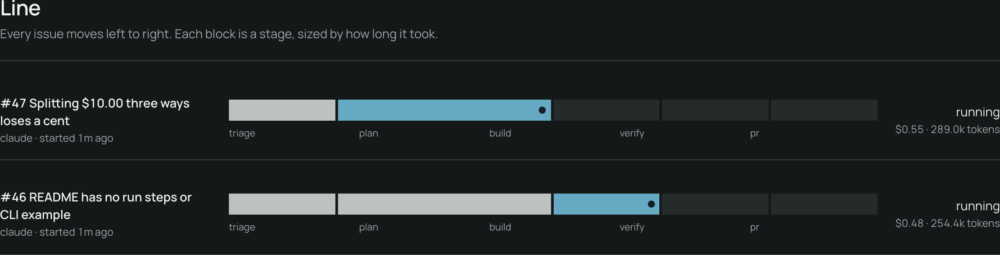
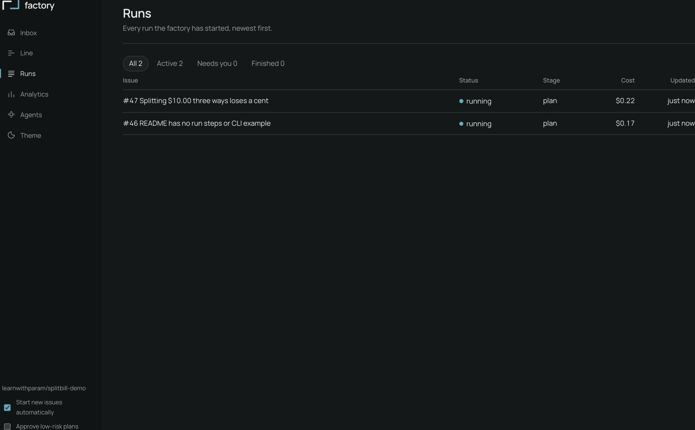

Triage and plan land on the issue as comments:

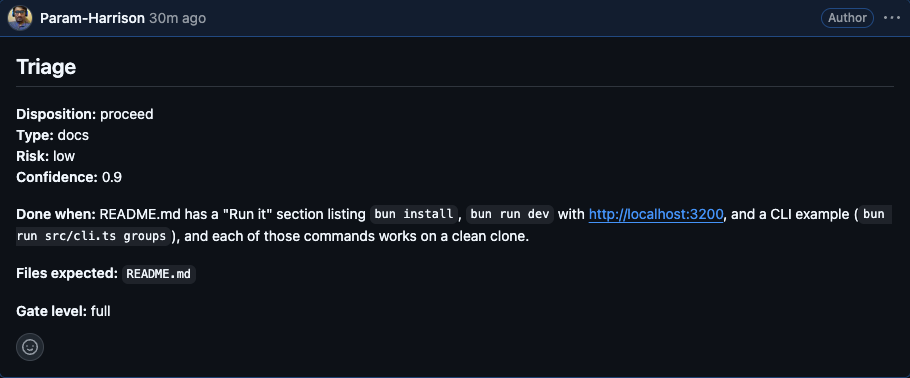
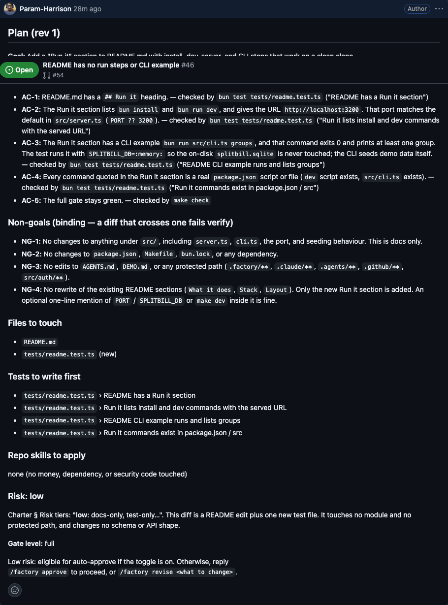

Then label [#51](https://github.com/learnwithparam/splitbill-demo/issues/51) (hono). Its plan is high risk,
so it stops at `factory:awaiting-approval`. Comment `/factory cancel`: the issue closes, its worktree is
removed, and the `factory/issue-51` branch is kept.

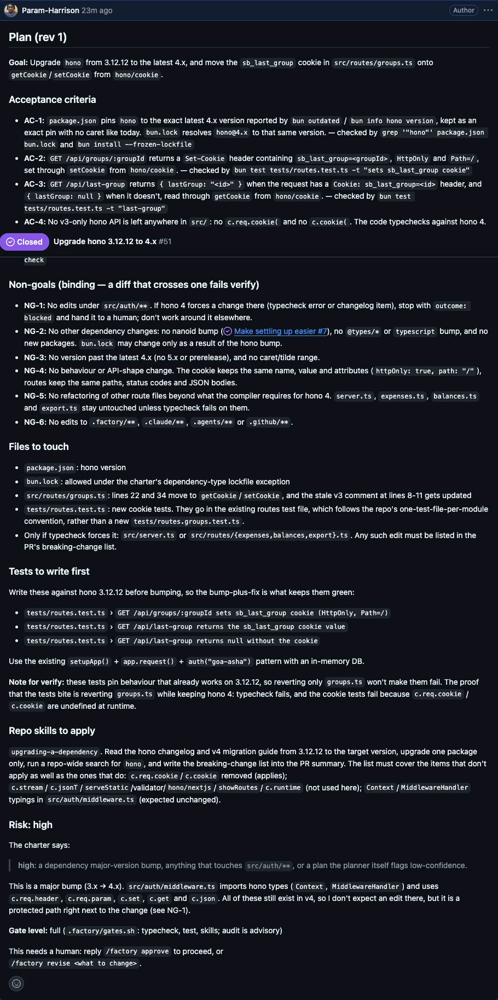
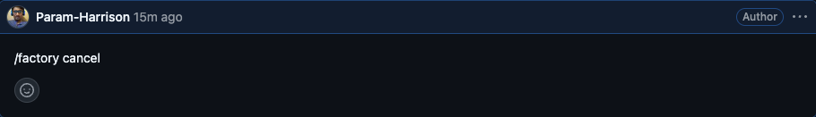
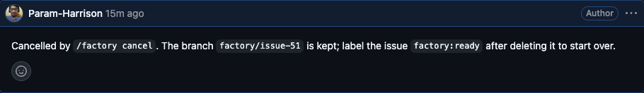

### Step 2: sandbox boundaries

Show what bounds an agent: [.factory/config.json](https://github.com/learnwithparam/splitbill-demo/blob/main/.factory/config.json)
(`agentCommands`, gates, `protectedPaths`) and
[.claude/hooks/guard-paths.sh](https://github.com/learnwithparam/splitbill-demo/blob/main/.claude/hooks/guard-paths.sh).

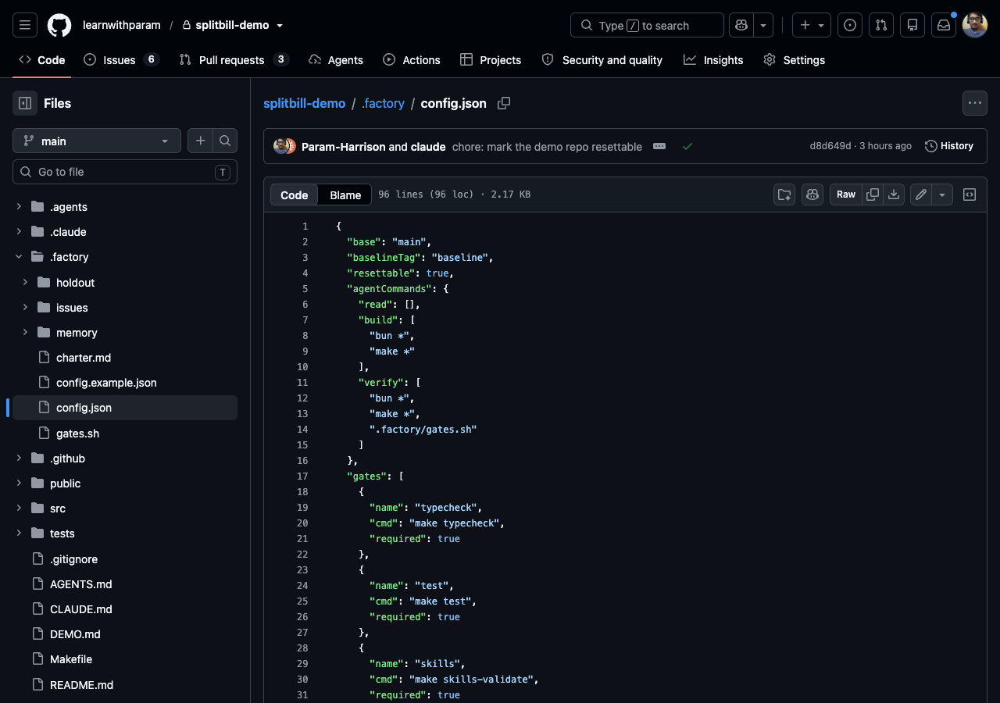
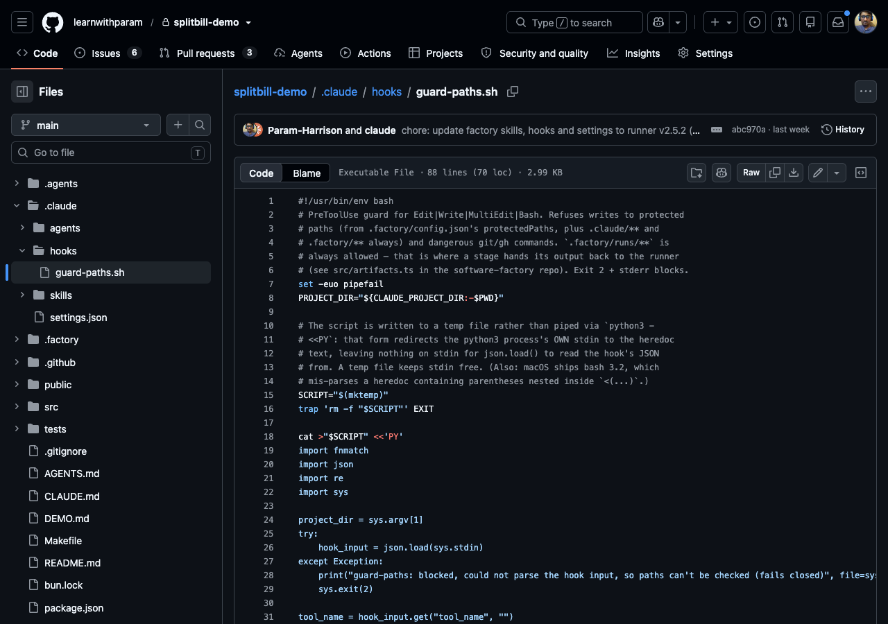

Label [#50](https://github.com/learnwithparam/splitbill-demo/issues/50). The fix needs
`src/auth/permissions.ts`, a protected path, so triage refuses it. Nothing is planned or built.

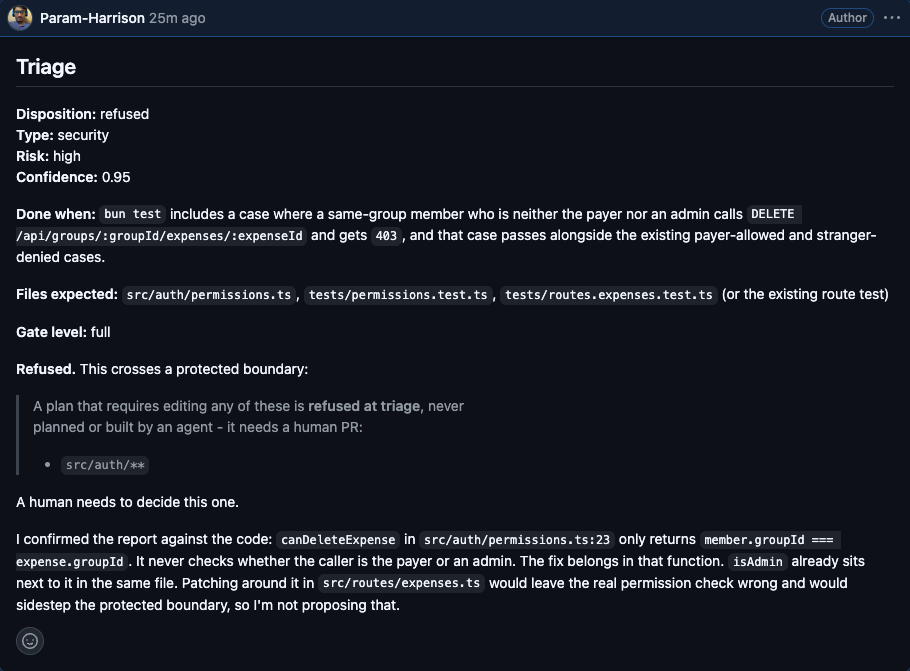

### Step 3: one execution harness

Follow #46 and #47 through build, verify and PR. While they run, the line shows each stage live, and
anything waiting on a human collects in the inbox.

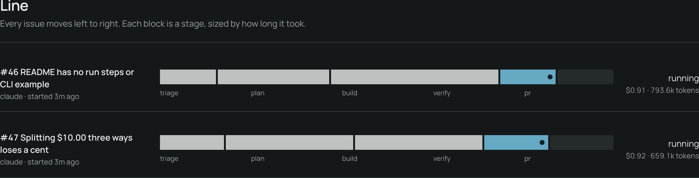
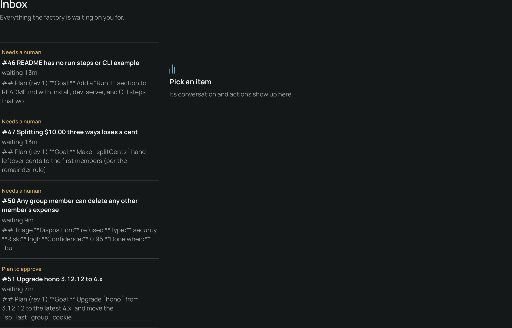

Both verdicts are posted on the issue:

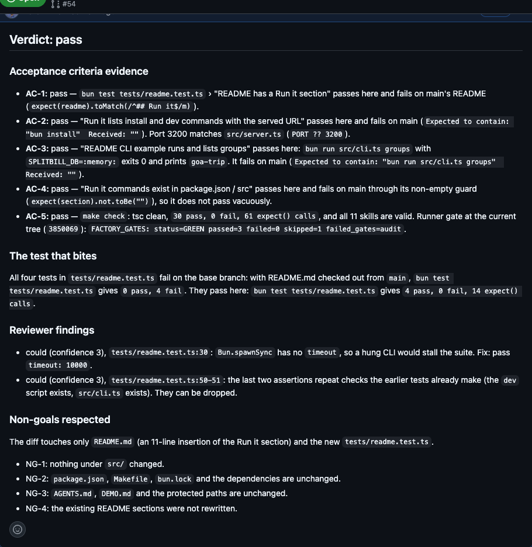
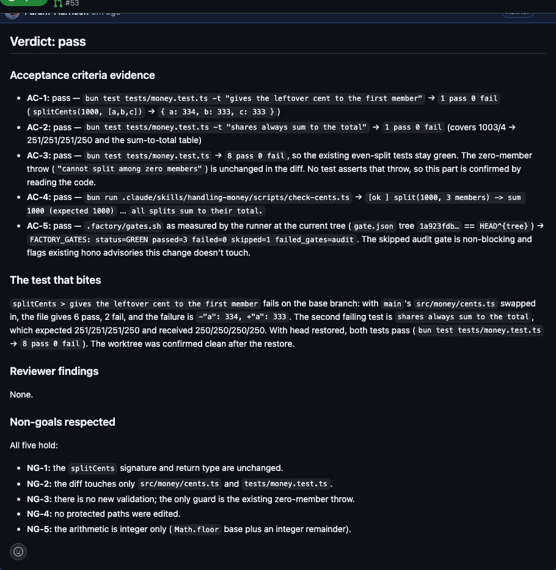

[PR #53](https://github.com/learnwithparam/splitbill-demo/pull/53) closes #47 and carries the plan, gate
evidence, verdict, risk and the "Factory run" table:

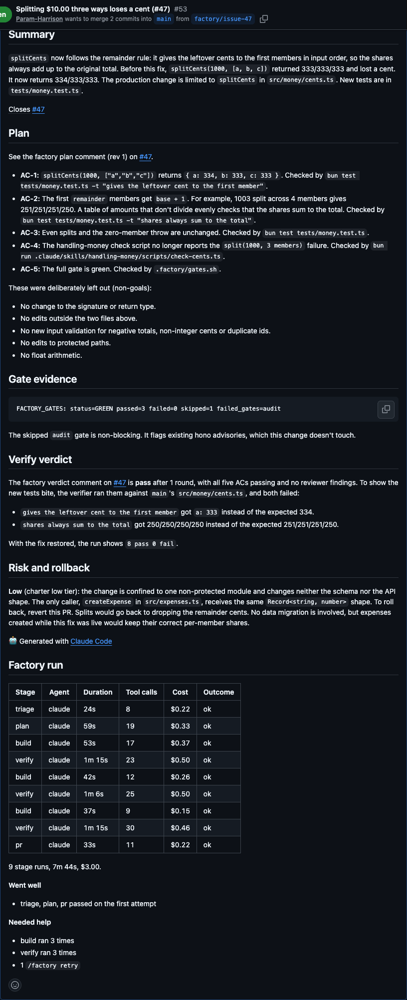

On [PR #54](https://github.com/learnwithparam/splitbill-demo/pull/54), comment
`/factory revise add a curl example for GET /api/groups`:

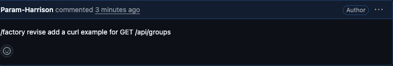

On v2.12.0 this reran build, but nothing changed. Bug 3 below has the cause.

### Step 4: your branch stays isolated

In `splitbill-demo/`:

```bash
git status --short
git branch --show-current
git worktree list
```

You are still on `my-feature` with the one edit, and every factory worktree sits beside your checkout under
`~/.factory/`.

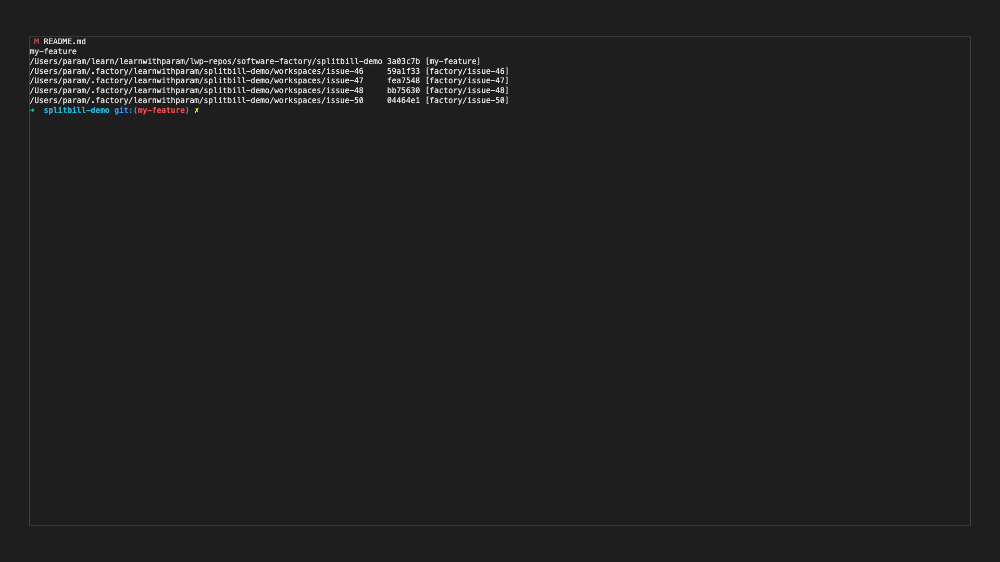

### Step 5: watch and take over

Label [#48](https://github.com/learnwithparam/splitbill-demo/issues/48). Mid-build, run
`bin/factory takeover 48`. The issue's Claude session resumes in your terminal, and the issue says so:


Steer it ("add a test that a 1-cent expense exports as 0.01"), then `/exit`. The handback posts
`/factory retry`, and the factory resumes at build with the worktree as you left it:

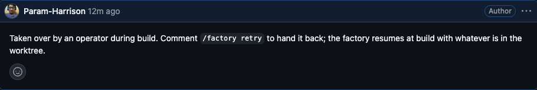

[PR #55](https://github.com/learnwithparam/splitbill-demo/pull/55)'s "Factory run" table records the
takeover as its own build row:

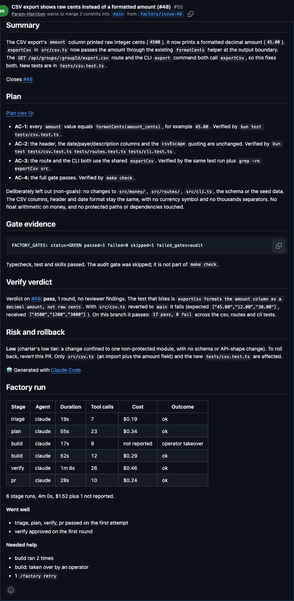

### Step 6: the whole run

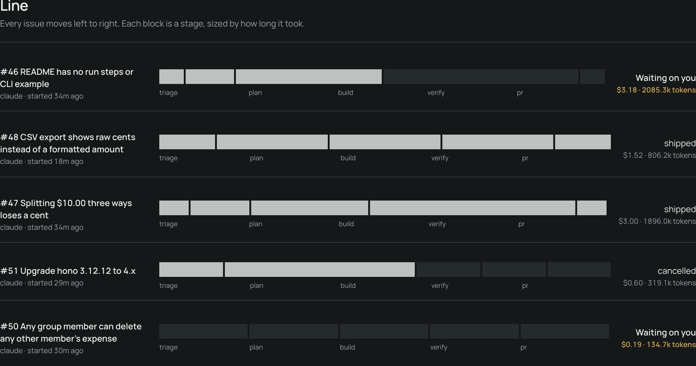
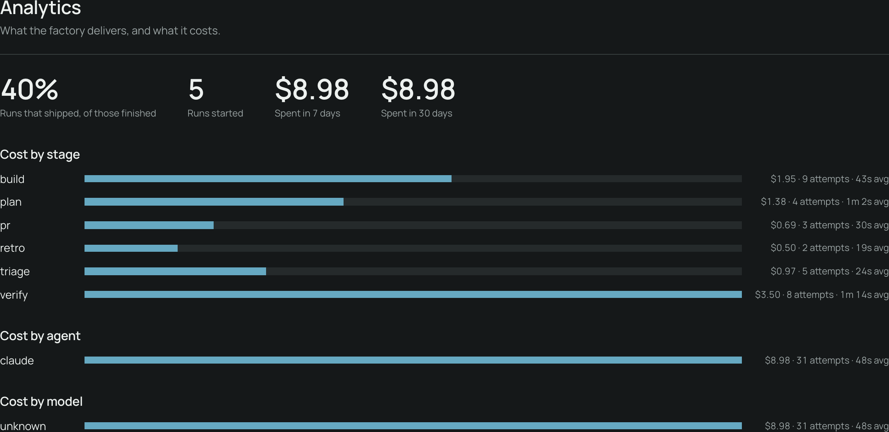

Close with `bin/factory reset --repo-dir ../splitbill-demo --dry-run`, then the reset, then stop the
watcher with Ctrl-C.

### What this run found (fixed in v2.12.1)

1. **A parked `/factory retry` re-fired every poll.** An `uncertain` verify parked without a comment, so
   the retry stayed the latest human comment. PR #53's run table shows three build and verify rounds from
   one retry.
2. **An uncertain verdict was not posted**, so `needs-human` had no reason on GitHub.
3. **A PR `/factory revise` changed nothing.** Only the plan skill read `revise.md`; build saw a finished
   plan (PR #54).

All three are fixed in [software-factory PR #23](https://github.com/learnwithparam/software-factory/pull/23).
Also note: a chatops command must start the comment. `/factory retry` on the last line of a longer comment
is ignored.

## By release

Each section names one thing to show for that factory release. Run them from `../factory`.

### v2.3: the boundary tells the truth

Label "README has no run steps" `factory:ready`, then comment `/factory cancel` while it waits for plan approval.
The issue closes, the PR (if any) closes, and the worktree is gone. Then `bin/factory doctor --repo-dir ../splitbill-demo --json`
shows every check and exits 4 if one fails.

### v2.4: the cockpit

`bin/factory inbox --repo-dir ../splitbill-demo` lists what waits on you. Acting from the dashboard Inbox or with
`bin/factory inbox 12 approve` posts the same `/factory approve` comment you would type. `bin/factory logs 12 --follow`
tails the run.

### v2.5: any agent, counted honestly

Run the cent-split issue and open Analytics: each stage shows its agent, tokens and cost. A stage whose agent reports no
usage shows "Not reported", never $0.00. Read-only stages (triage, plan, verify) cannot write files.

### v2.6: one factory, any agent

Open the Agents page: each preset, its pinned version, the installed version and its doctor rows. Add a second agent under
`agents` in `.factory/config.json` and point `stages.verify` at it. `bin/factory install --update` (or `install.sh --agents`)
links the skills into that agent's own directory.

### v2.6.1: presets that work on first use

`bin/factory verify-agent <name> --repo-dir ../splitbill-demo --issue <N>` runs one issue on that agent and records a fixture.
Only Claude is verified by the maintainers; the rest say "Verified by participants: not yet" until someone does.

### v2.6.2: any repo, safely

State lives under `~/.factory/<owner>/<repo>/`, so splitbill-demo and lwp-website (or any repo you point
`--repo-dir` at) share one binary without colliding. `bin/factory doctor --repo-dir <dir>` is safe to run on a
repo, like lwp-website, that has never opted into `reset`.

### v2.7.0: one machine, priced and capped

`.factory/config.json`'s `routes` can send `bug`/`feature`/`docs`/`security`/`dependency` issues to different
agents per stage; `FACTORY_SLOTS` and `spend.perIssueUsd`/`dailyUsd` are shared across every repo one machine
watches, not per repo. A plan can set `"proof": "check"` to prove non-test work (a docs page, a blog post) by
naming commands instead of writing a failing test first.

### v2.8.0: merge-policy, off until you turn it on

`.factory/config.json`'s `merge.policy` is `"off"` by default, `"dry-run"` posts an audit comment without
merging, `"auto"` merges once every gate holds and the diff fits `merge.autoPaths`/`maxFiles`/`maxLines`.
splitbill-demo and lwp-website both stay on the default; nothing here merges on its own.

### v2.9.0: the review inbox

`bin/factory inbox --repo-dir <dir>` lists what's waiting on you across every repo the factory watches, not
just one. The dashboard's review panel shows a PR's diff, CI status, gate evidence and verify verdict without
opening GitHub, with an "Approve and merge" button for the operator's own authority.

### v2.10.0: memory across runs

Every finished issue gets a read-only retro after its outcome, proposing at most one lesson for
`.factory/memory/lessons.md` (capped at 8 KiB, injected into every stage's context) or one skill edit.
`bin/factory learn --repo-dir <dir>` batches whatever's pending into its own PR; it never merges itself.

### v2.11.0: the holdout guarantee

`.factory/config.json`'s `holdout: { paths, cmd }` names a test suite no stage's agent ever sees:
`Git.excludeFromSparseCheckout` hides the paths from the worktree the moment it's created, and only the verify
stage runs `cmd`, against a scratch copy with those paths force-restored from `origin/main`. splitbill-demo's
first holdout test, `.factory/holdout/settle-up.holdout.test.ts`, checks that `settleUp()`'s transfers zero out
every member's balance. Run it directly with:

```bash
bun test ./.factory/holdout/settle-up.holdout.test.ts
```

A build that plants a regression in `src/balances.ts` (for example, dropping `Math.min(creditor.amount,
debtor.amount)` to just `creditor.amount`) can still pass its own `gates.sh` if nothing else exercises that
path; the holdout test catches it directly (confirmed in a throwaway worktree: the holdout runner reported a
non-zero exit with the exact failing assertion). In a real run that failure feeds the existing reject-and-
rebuild loop and escalates to `factory:needs-human` after `MAX_VERIFY_REJECTS`, the same as an AI-verifier
reject.

A second holdout, `.factory/holdout/csv-export.holdout.test.ts`, targets issue #11 (CSV export leaking raw
cents instead of a zero-padded decimal). Running `factory run --issue 11` live produced a real, unplanned
`factory:needs-human` outcome, but not through the reject-rebuild path above: the verdict was `uncertain`,
not `reject`. AC-1 to AC-3 (the build's own tests, including the exact zero-pad case the holdout also checks)
all passed, and `factory-verify`'s revert-and-reprove step confirmed the fix - reverting `src/csv.ts` to base
made the new tests fail with the raw-cents values, restoring it made them pass again. What tripped `uncertain`
was AC-4, the gate line itself: `gate.json`'s recorded tree (`af942b4`) no longer matched `HEAD^{tree}`
(`328d1d0`) by the time verify ran, because the branch had picked up the second holdout file being merged to
`main` in between - a tree difference limited to `.factory/holdout/**`, nothing in `src/` or `tests/`. Per
`factory-verify/SKILL.md`'s own rule ("if the tree differs... the evidence is stale: report uncertain"), the
verifier declined to trust the stale `gate.json` line, could not re-run `.factory/gates.sh` itself (the
sandbox blocks execution under `.factory/**`), and instead reproduced each gate command by hand (typecheck,
`bun test`, skills validation) - which matched, but on a rebuilt tree it can't certify as the one `gates.sh`
graded. It escalated rather than guess. This is the harness working as designed: a correct fix still goes to
a human when the evidence backing it goes stale, which is a real edge of the same "when the factory stops"
guarantee the reject-rebuild loop gives you, not a failure of it.

The baseline's `holdout.cmd` runs only the settle-up suite. `csv-export.holdout.test.ts` stays in
`holdout.paths`, so agents never see it, but it is not run: at baseline the seeded CSV defect makes it fail,
and verify fails on any holdout failure, which would reject every unrelated issue. Add it back to `cmd` in the
same PR that fixes issue #11.

### v2.12.0: watch and take over

`factory watch --tmux` gives each running issue its own tmux window, `factory attach <N>` jumps to it, and
`factory takeover <N>` hands the stage's Claude session to you; `/exit` hands it back with `/factory retry`.
The PR body gains a "Factory run" table (stage, agent, duration, tool calls, cost, outcome), and
`factory doctor` reports skill drift. Step 5 above shows all of it on a real run.
